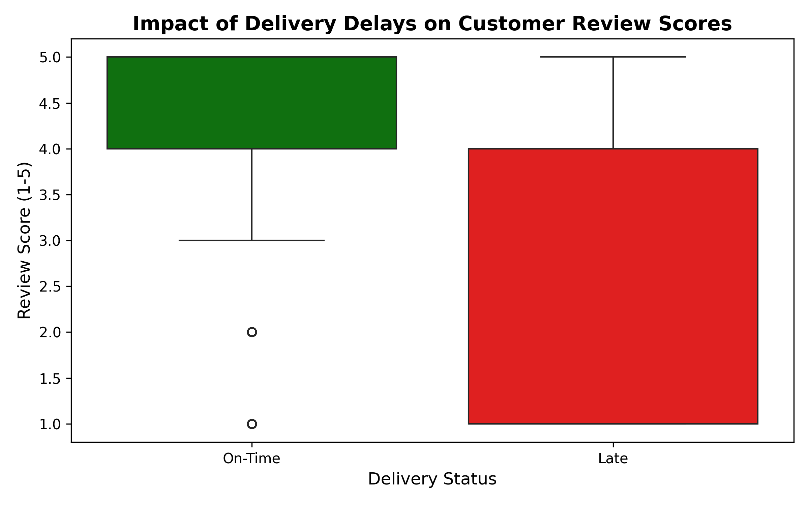
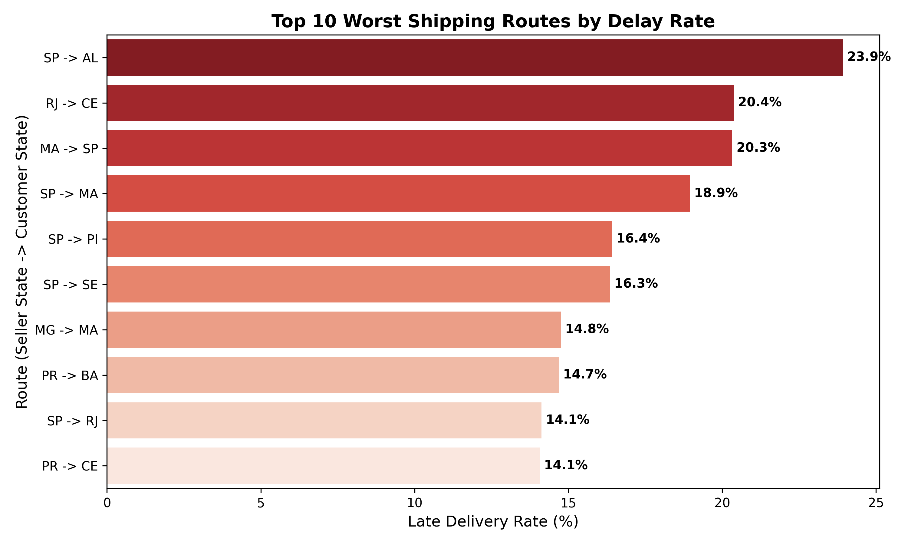
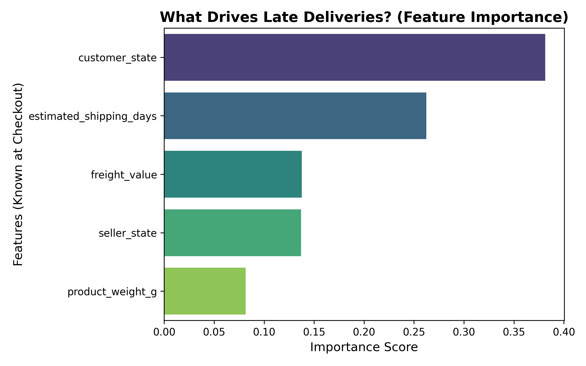
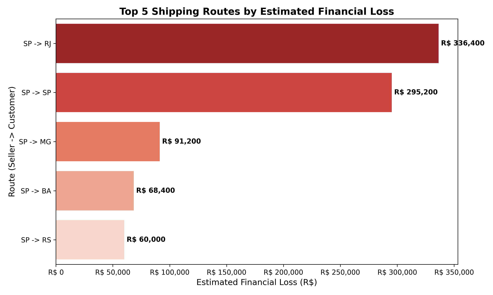

#  Delivery Delay Analytics: An Empirical Study of E-Commerce Logistics Bottlenecks

[](https://www.linkedin.com/in/anandhu-suresh-in/)
[](anandhu.suresh.dev.email@gmail.com)


##  Executive Summary
This project is an end-to-end data analytics and machine learning study designed to identify the root causes of delivery delays in e-commerce, quantify their impact on customer satisfaction, and simulate the financial ROI of logistics interventions. 

Using the **Olist Brazilian E-Commerce Dataset** (approx. 96,000 delivered orders across 9 relational tables), this study moves beyond basic EDA by applying rigorous statistical hypothesis testing, predictive modeling, and a business impact simulation to provide actionable recommendations for management.

##  Business Context
Prior industry research indicates that 67% of shoppers lose trust after a single bad delivery experience, and delayed deliveries can reduce product ratings by an average of 0.4 stars. This project builds on that context to quantify the exact financial impact of those delays and identify exactly *where* the logistics network is failing.

##  Key Findings (TL;DR)
*   **Customer Satisfaction (RQ1):** Late deliveries cause a catastrophic drop in ratings. On-time orders average **4.29 / 5** stars, while late orders plummet to **2.27 / 5** (Cliff's Delta = -0.637, indicating a massive practical effect).
*   **Operational Bottleneck (RQ2):** The `SP -> RJ` (São Paulo to Rio de Janeiro) shipping route is the most financially damaging bottleneck. It accounts for **1,152 late orders** and **841 bad reviews**.
*   **Predictive Power (RQ3):** A Random Forest model (using SMOTE to handle imbalance) successfully predicts late deliveries *before dispatch* with an **AUC-ROC of 0.68**. The top predictors are `customer_state` and the `estimated_shipping_days` promised at checkout.
*   **Financial Impact (ROI):** Late deliveries cost the company an estimated **R$ 1,592,000** (assuming Refund + Customer Lifetime Value loss). A targeted 25% improvement on the worst route (`SP -> RJ`) would prevent 210 bad reviews and save **R$ 84,000**.

##  Tech Stack & Methodology
*   **Data Manipulation:** `pandas`, `numpy`
*   **Statistical Testing:** `scipy.stats` (Mann-Whitney U, Chi-Square, Cramér's V, Cliff's Delta)
*   **Machine Learning:** `scikit-learn` (Random Forest), `imbalanced-learn` (SMOTE)
*   **Visualization:** `matplotlib`, `seaborn`

*(Note: For a deep dive into the statistical hypotheses and data engineering logic, please read [`docs/methodology.md`](docs/methodology.md).)*

##  Visual Highlights

| Impact of Delays on Reviews | Top 10 Worst Routes |
|:---:|:---:|
|  |  |

| Feature Importance (Drivers of Delay) | Financial Impact (ROI) |
|:---:|:---:|
|  |  |

##  Project Structure
```text
Logistics_Optimizer/
│
├── data/
│   └── raw/                  # Original 9 Olist CSVs (Download from Kaggle)
│
├── src/                      # Modular Python Scripts
│   ├── data_merger.py        # Merges 9 tables, handles dates & aggregations
│   ├── process_eda.py        # Statistical hypothesis testing (Mann-Whitney, Chi-Square)
│   ├── ml_delay_predictor.py # Random Forest Classifier & Feature Importance
│   └── business_impact.py    # ROI simulation and financial loss calculation
│
├── notebooks/
│   └── Logistics_Exploration.ipynb # Main Jupyter Notebook with full analysis
│
├── visualizations/           # High-res PNG charts used in this README
│
├── docs/                     
│   ├── methodology.md        # Statistical approach and data logic
│   └── business_assumptions.md # Financial formulas and ROI assumptions
│
├── .gitignore                # Excludes data/ and .venv/ from GitHub
├── requirements.txt          # Python dependencies
└── README.md
```

##  How to Reproduce
1. **Clone the repository:**
   git clone https://github.com/anandhusuresh04/Logistics_Optimizer.git
   cd Logistics_Optimizer

2. **Set up the virtual environment:**
   python -m venv .venv
   source .venv/bin/activate  # On Windows: .\.venv\Scripts\activate
   pip install -r requirements.txt

3. **Download Data:** Download the 9 tables from the [Olist Kaggle Dataset](https://www.kaggle.com/datasets/olistbr/brazilian-ecommerce) and place them in `data/raw/`.

4. **Run the Pipeline:**
   python src/data_merger.py
   python src/process_eda.py
   python src/ml_delay_predictor.py
   python src/business_impact.py
   
   *(Alternatively, open the Jupyter Notebook to view the step-by-step execution and charts.)*

##  Limitations
*   **Observational Data:** The study uses historical observational data; correlation does not imply causation.
*   **Financial Assumptions:** Financial figures (R\$ 150 refund, R\$ 250 CLV loss) are assumed baselines based on industry averages, not proprietary company data. 
*   **Temporal Scope:** The dataset covers 2016–2018 and may not reflect post-pandemic logistics realities.

---
*Developed by Anandhu Suresh | 2026*